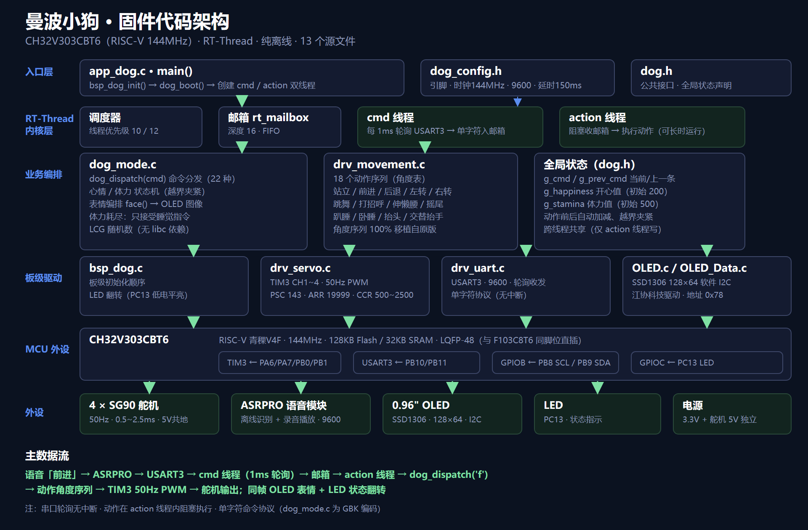

# 曼波小狗 · CH32V303CBT6 + RT-Thread（纯离线版）

桌面四足机器狗的RISC-V移植：主控由 **STM32F103C8T6** 进行移植开发 **CH32V303CBT6**
（青稞 RISC-V V4F，144MHz，128KB Flash / 32KB SRAM）
**RT-Thread**通过 **ASRPRO 离线语音模块** 控制
**4 个 SG90 舵机** 与 **0.96 英寸 OLED** 表情。

## 特性

- **RISC-V 144MHz 主控**：CH32V303CBT6（青稞 V4F / 144MHz / 128KB Flash / 32KB SRAM / LQFP-48）
- **纯离线**：无 WiFi、无蓝牙、无云端；语音识别与录音播放全部由 ASRPRO 离线模块完成
- **ASRPRO 语音**：单字符命令协议（USART3，9600），支持语音唤醒
- **4 × SG90 舵机**：TIM3 四路 50Hz PWM（PA6 / PA7 / PB0 / PB1）
- **OLED 表情**：0.96" SSD1306（PB8 / PB9 软件 I2C，地址 0x78），实时显示心情 / 体力值
- **RT-Thread**：cmd / action 双线程 + 邮箱；动作逻辑 100% 移植自原版 manbo-robot-dog

## 主控替换说明

| 项目 | 原 STM32F103C8T6 | 新 CH32V303CBT6 |
|---|---|---|
| 内核 | ARM Cortex-M3 | 青稞 RISC-V V4F |
| 主频 | 72 MHz | 144 MHz |
| Flash | 64 KB | 128 KB |
| SRAM | 20 KB | 32 KB |
| 封装 | LQFP-48 (7×7) | LQFP-48 (7×7)，引脚编号与 F103 完全一致 |
| 串口 | USART1/2/3 | USART1/2/3 + UART4/5 等 |
| 定时器 | TIM1-4 | TIM1-4（高级 + 通用）|
| 网络 | — | 纯离线，无 WiFi 无云 |
| LCSC 编号 | C8734 | C7494374 |

CH32V303CBT6 是 LQFP-48，且引脚编号与 STM32F103C8T6 相同**（PA6=16、PA7=17、PB0=18、
PB1=19、PB2=20、PB10=21、PB11=22、VSS=23、VDD=24、PB12=25…PB15=28、PA8=29…PA11=32、PA12=33、
PA13=34、VSS=35、VDD=36、PA14=37、PA15=38、PB3=39…PB7=43、BOOT0=44、PB8=45、PB9=46、VSS=47、VDD=48）。


## 硬件接线表

| 功能 | 引脚 | LQFP48 脚 | 备注 |
|---|---|---|---|
| 舵机1 右前 | PA6 | 16 | TIM3_CH1，50Hz PWM |
| 舵机2 右后 | PA7 | 17 | TIM3_CH2 |
| 舵机3 左前 | PB0 | 18 | TIM3_CH3 |
| 舵机4 左后 | PB1 | 19 | TIM3_CH4 |
| OLED SCL | PB8 | 45 | 软件 I2C，地址 0x78 |
| OLED SDA | PB9 | 46 | 软件 I2C |
| ASR TX | PB10 | 21 | USART3，9600，轮询收发 |
| ASR RX | PB11 | 22 | USART3 |
| LED | PC13 | 2 | 板载，低电平点亮 |
| SWDIO | PA13 | 34 | WCH-Link 烧录 |
| SWCLK | PA14 | 37 | WCH-Link 烧录 |
| NRST | — | 7 | 复位 |
| BOOT0 | — | 44 | 串口 ISP 烧录时接高电平 |
| BOOT1 | PB2 | 20 | |
| 晶振 | PC14 / PC15 | 3 / 4 | 原板 8MHz 晶振（固件用内部时钟） |
| 晶振 | PD0 / PD1 | 5 / 6 | |
| 电源 VDD ×3 | — | 24 / 36 / 48 | 3.3V |
| 地 VSS ×3 | — | 23 / 35 / 47 | GND |
| 备份 / 模拟 | VBAT / VDDA / VSSA | 1 / 9 / 8 | |

> 舵机 5V 必须单独供电

## 脚位表（CH32V303CBT6 LQFP-48，引脚号即芯片脚位）

| 功能 | 引脚名 | LQFP48 脚 | 备注 |
|---|---|---|---|
| 舵机1右前 | PA6 | 16 | TIM3_CH1 |
| 舵机2右后 | PA7 | 17 | TIM3_CH2 |
| 舵机3左前 | PB0 | 18 | TIM3_CH3 |
| 舵机4左后 | PB1 | 19 | TIM3_CH4 |
| OLED SCL | PB8 | 45 | 软件 I2C |
| OLED SDA | PB9 | 46 | 软件 I2C |
| ASR TX | PB10 | 21 | USART3 |
| ASR RX | PB11 | 22 | USART3 |
| LED | PC13 | 2 | 低电平点亮 |
| SWDIO | PA13 | 34 | |
| SWCLK | PA14 | 37 | |
| NRST | — | 7 | |
| BOOT0 | — | 44 | |
| BOOT1 | PB2 | 20 | |
| 晶振 | PC14/PC15 | 3/4 | 原板 8MHz 晶振（固件用内部时钟） |
| 晶振 | PD0/PD1 | 5/6 | |
| 电源 | VDD×3 | 24/36/48 | 3.3V |
| 地 | VSS×3 | 23/35/47 | |
| 备份/模拟 | VBAT/VDDA/VSSA | 1/9/8 | |

完整说明见 [docs/pin-mapping.md](docs/pin-mapping.md)。

## 直插替换 4 步流程

1. **焊下**原板上的 STM32F103C8T6（LQFP-48）。
2. **清理焊盘**（吸锡带拖平，少量助焊剂），核对丝印 **引脚 1 的圆点 / 缺角方向**。
3. **焊上** CH32V303CBT6（同 LQFP-48、同引脚编号），**注意引脚 1 方向**，四边对齐后拖焊。
4. **烧录验证**：无需转接板、无需改板；原板晶振、电源、外设电路全部不动。
   用 **WCH-Link** 走 PA13(SWDIO) / PA14(SWCLK) 烧录，或走串口 ISP（BOOT0 接高电平）。

详见 [docs/direct-replacement.md](docs/direct-replacement.md)。

## 目录结构

```
.
├── README.md                # 本文件
├── LICENSE                  # MIT 许可证
├── .gitignore
├── firmware/                # 固件源码（RT-Thread 应用层）
│   ├── dog_config.h         # 引脚 / 波特率 / 常量（唯一需要按板子修改的文件）
│   ├── dog.h                # 公共接口 + 全局状态
│   ├── bsp_dog.c            # 板级初始化 + LED
│   ├── drv_servo.c          # TIM3 四路舵机 PWM
│   ├── drv_movement.c       # 全部步态 / 动作
│   ├── drv_uart.c           # 语音识别串口（轮询收发）
│   ├── dog_mode.c           # 动作编排 + 命令分发 + 心情/体力（GBK 编码）
│   ├── app_dog.c            # RT-Thread 线程（cmd / action）
│   └── OLED.c / OLED.h / OLED_Data.c / OLED_Data.h   # 江协科技 SSD1306 驱动（已适配 ch32v30x）
└── docs/
    ├── pin-mapping.md       # CH32V303CBT6 同脚位引脚表
    ├── direct-replacement.md # 同脚位直插替换流程与注意事项
    └── bom.md               # BOM 清单
```

## 📦 复现指南（先看这里）

**复现这个项目需要的条件**（缺一不可，请先自查）：

| 需要 | 说明 |
|---|---|
| 硬件 | 原版曼波机器狗 PCB（[oshwhub](https://oshwhub.com/herobrine/stm32-mambo-robot-dog) 打样/购买）+ CH32V303CBT6 + 4×SG90 + ASRPRO 模块 + WCH-Link（详见 [docs/hardware.md](docs/hardware.md)） |
| 技能 | 会 LQFP-48 芯片焊接（0.5mm 间距）、会用 RT-Thread Studio 建工程、会用天问Block 配语音模块 |
| 时间 | 硬件打样 3-5 天 + 焊接调试 1-2 天 |

**三个配套文档（缺了它们复现会卡住）：**

1. 🔧 [docs/build.md](docs/build.md) —— **编译工程搭建全流程**：RT-Thread Studio 步骤、rtconfig.h 关键项（开 mailbox / 器件宏 CH32V30x_D8）、link.ld 128K/32K、常见报错解决；
2. 🎙 [docs/asrpro-config.md](docs/asrpro-config.md) —— **ASRPRO 词条对照表**（"前进"→`f` 等 25 条）+ 天问Block 配置步骤 + 串口 9600 设置；
3. 📋 [docs/hardware.md](docs/hardware.md) —— **整机物料清单**（含电池/舵机/喇叭/外壳/采购渠道/成本估算）。

> 💡 没有 ASRPRO 模块也能测试全部动作逻辑：用 USB-TTL 接 PB10/PB11（9600 8N1），串口助手直接发命令字符即可。

> 📦 **关于预编译固件**：仓库暂不提供 `.hex`（固件依赖完整 RT-Thread 工程才能链接产出），请按 [docs/build.md](docs/build.md) 自行编译；编译成功后用 tools/ 里的 WCH-LinkUtility 烧录即可。

## 🚀 快速开始
**前提**：用 RT-Thread Studio（**RT-Thread 5.1.x 或更高**）基于官方 BSP「CH32V307V-R1」（路径 `bsp/wch/risc-v/ch32v307v-r1`）新建工程
（V303 与 V307 同内核、同外设寄存器，可直接使用该 BSP），或用 WCH MRS 的 CH32V303 工程。
**注意**：V303 的 Flash 为 **128KB**、SRAM 为 **32KB**，需把链接脚本（`link.ld`）改为 **128K / 32K**。

1. 将 [firmware/](firmware/) 下所有 .c/.h 拷入工程的 `applications/`（或新建 `dog/` 目录并加入编译）。
2. 删除或覆盖工程自带的 `applications/main.c`（本工程 `app_dog.c` 已提供 `int main(void)`）。
3. 确认 `rtconfig.h`：
   - 开启 `RT_USING_MAILBOX`（动作线程用到邮箱）；
   - 关闭 `RT_USING_SERIAL`，或不启用 uart3 设备（固件直接操作 USART 外设，避免冲突）；
   - `rt_snprintf` 由内核提供，无需 newlib；未启用 libc 时也无需开 `RT_USING_LIBC`。
4. 编译烧录：MounRiver / RT-Thread Studio + WCH-Link（PA13 / PA14 SWD）。

###  必须核对 / 自测的 3 个点

1. **主频必须 144MHz**：固件按 `DOG_TIM_CLK_HZ = 144MHz` 计算预分频。主频不对，定时器 / 舵机 50Hz、
   串口波特率都会偏。若你的板子主频不是 144MHz，改 `firmware/dog_config.h` 里的 `DOG_TIM_CLK_HZ`
   （舵机频率必须保持 50Hz，否则会抖、发热）。
2. **OLED 地址**：默认 0x78（`OLED.c` 内 `OLED_WriteCommand` / `OLED_WriteData` 里写死）。
   若你的屏是 0x7A / 0x3C，改那两处。
3. **中文编码**：`dog_mode.c` 必须保存为 GBK/GB2312（已按 GBK 写好），否则注释乱码。
   MounRiver：项目 → Properties → Resource → Text file encoding → GBK。
   > GitHub 网页上看到 `dog_mode.c` 中文注释乱码是**正常现象**（文件按 GBK 存储，网页按 UTF-8 显示），
   > 不影响编译；按上面设置 GBK 编码即可正常打开。


## 烧录与工具

| 工具 | 用途 | 位置 |
|---|---|---|
| `tools/WCH-LinkUtility.exe` | SWD 烧录工具（WCH-Link，GUI） | 本仓库 |
| `tools/WCHLinkDrv_WHQL_S.exe` / `CH372DRV_S.exe` | WCH-Link 驱动 | 本仓库 |
| WCH-LinkE 硬件 | USB 转 SWD 调试器（约 ¥20） | 淘宝/立创搜 "WCH-LinkE" |
| MounRiver Studio | 官方 IDE（编译 + 一键下载） | [mounriver.com/download](https://www.mounriver.com/download) |
| WCHISPTool | USB ISP 烧录（无 WCH-Link，BOOT0 拉高） | [wch.cn 下载](https://www.wch.cn/downloads/WCHISPTool_Setup.html) |
| wchisp（可选） | 开源命令行烧录器 | [github.com/ch32-rs/wchisp](https://github.com/ch32-rs/wchisp) |

**接线**（WCH-Link → CH32V303CBT6）：SWDIO → PA13(34脚)、SWCLK → PA14(37脚)、GND → GND、3V3 → 3.3V。
**烧录步骤**：安装驱动 → WCH-LinkUtility 选芯片 CH32V303 → Read Chip Info 验证连接 → Open File 选 .hex → Download。
详细图文说明见 [`tools/README.md`](tools/README.md)（含 USB ISP、命令行、常见问题排查）。

### 编译参数

```bash
riscv64-unknown-elf-gcc -march=rv32imafc -mabi=ilp32f -DCH32V30x_D8 ...
```

- 器件宏须是 `CH32V30x_D8`**（CH32V303）；不定义时 SDK 默认按 CH32V307（`D8C`）编译；
- 内核参数 `rv32imafc`（注意字母顺序，写成 `rv32imacf` 会报错）+ ABI `ilp32f`；
- Flash 128KB / SRAM 32KB（链接脚本需相应配置）；
- 本仓库固件已用官方 SDK 头文件 + RISC-V GCC 10.2 实测 **8/8 文件编译通过**。

### 固件架构



## 🔗 参考链接

| 内容 | 链接 |
|---|---|
| 原工程（立创开源广场 oshwhub） | https://oshwhub.com/herobrine/stm32-mambo-robot-dog |
| 原固件源码（STM32F103） | https://github.com/RussellCooper-DJZ/manbo-robot-dog |
| 原版 B 站视频 | https://www.bilibili.com/video/BV1UmUfBNEwu |
| 外壳 3D 打印模型（MakerWorld） | https://makerworld.com.cn/zh/models/1937892-stm32man-bo-ji-qi-ren-wai-ke |

##  第三方版权声明

本项目代码以 **MIT License** 发布
第三方组件保留其各自权利：

- **OLED 驱动**（OLED.c / OLED_Data.c / OLED.h / OLED_Data.h）版权归**江协科技**，本项目仅做 CH32V303 适配；
- **动作 / 表情逻辑**版权归原 **manbo-robot-dog** 作者（https://github.com/RussellCooper-DJZ/manbo-robot-dog，MIT 许可）；
- **原硬件设计**（PCB / 外壳）版权归原工程作者 herobrine（立创开源广场 oshwhub）。
